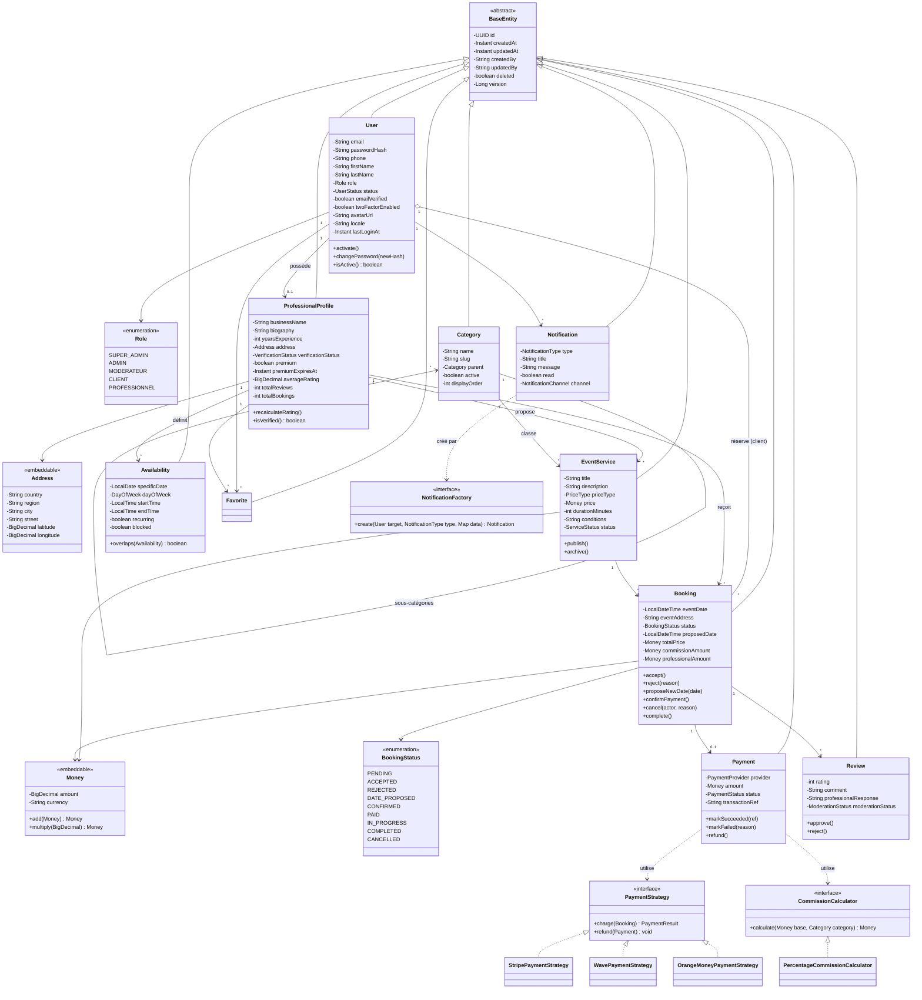

# Diagramme de classes (domaine principal)

## Patterns appliqués visibles sur ce diagramme

- **Strategy** : `PaymentStrategy` (Stripe / Wave / Orange Money / Mobile Money) et
  `CommissionCalculator` (pourcentage global vs override par catégorie).
- **Factory** : `NotificationFactory` construit le bon type de notification/canal.
- **Value Object (DDD)** : `Money`, `Address` en `@Embeddable`, immuables.
- **Aggregate Root (DDD)** : `Booking` est racine d'agrégat pour `BookingStatusHistory`
  et référence `Payment` en 1-0..1 (invariant : un seul paiement actif par réservation).
- **State Machine** : `BookingStatus` avec transitions contrôlées dans les méthodes
  métier de `Booking` (`accept()`, `reject()`, `cancel()`...) — jamais de `setStatus()` public.
