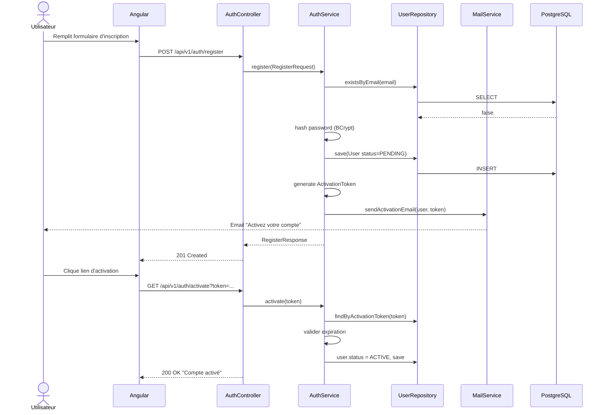
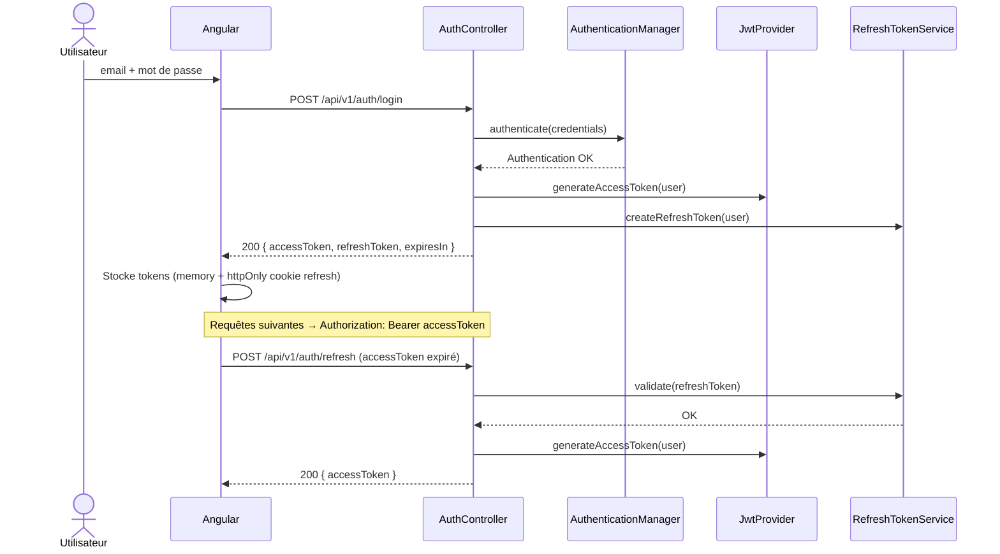
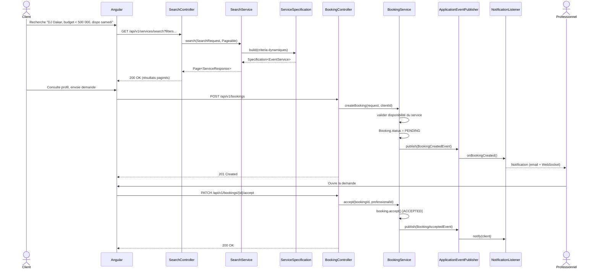
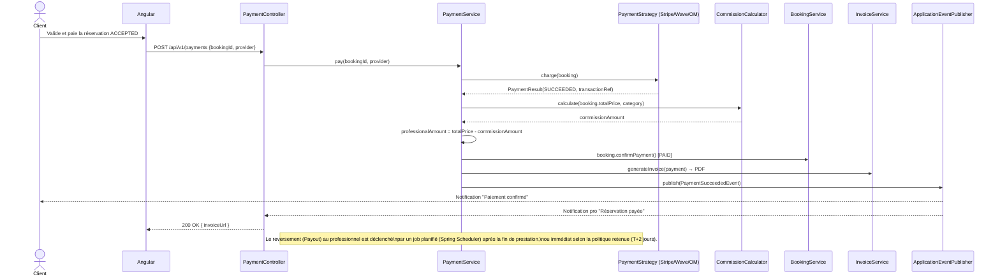
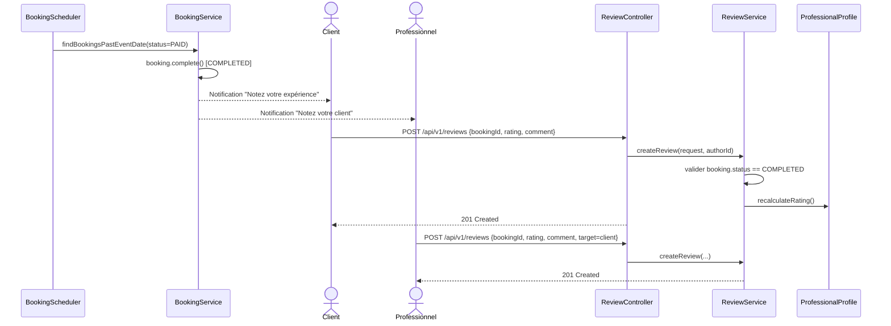

# Diagrammes de séquence — flux principaux

## 1. Inscription + activation par email

## 2. Connexion (JWT + refresh token)

## 3. Recherche + réservation + acceptation

## 4. Paiement + commission + reversement

## 5. Fin de prestation + avis bidirectionnel

