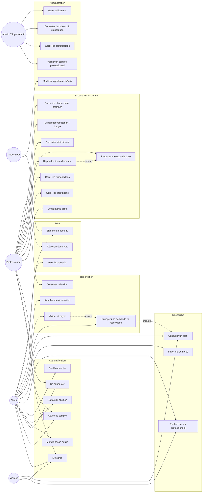

# Diagramme de cas d'utilisation

## Description textuelle des cas d'usage critiques

| Cas d'usage | Acteur | Pré-condition | Post-condition |
|---|---|---|---|
| Envoyer une demande de réservation | Client | Authentifié, prestation publiée | `Booking` créé en statut `PENDING`, notification envoyée au pro |
| Répondre à une demande | Professionnel | Booking `PENDING` lui appartenant | Statut → `ACCEPTED` / `REJECTED` / `DATE_PROPOSED` |
| Valider et payer | Client | Booking `ACCEPTED` ou `DATE_PROPOSED` acceptée | Paiement `SUCCEEDED`, commission calculée, Booking → `PAID` |
| Noter la prestation | Client & Professionnel | Booking `COMPLETED` | `Review` créée, moyenne recalculée |
| Valider un compte professionnel | Admin | Documents soumis (`UserDocument` `PENDING`) | `verification_status` → `VERIFIED`, badge attribué |
